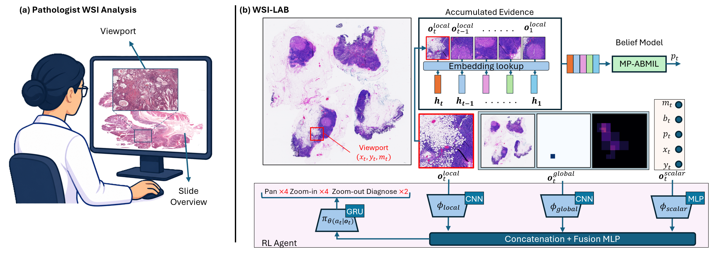

# WSI Lab

[paper](https://openreview.net/forum?id=y5vMVs7QSp)

`wsi-lab` is a research package for sequential examination of whole-slide
images (WSIs). It builds a dense six-level navigation hierarchy, attaches
sparse tissue-filtered UNI-v2 evidence, trains a calibrated gated-attention
multiple-instance-learning belief model, and provides a local recurrent-PPO
implementation for the Gymnasium environment `WSILab-v0`.

The package supports the native layouts of CAMELYON16, CAMELYON17, a combined
CAMELYON16/17 binary cohort, and TCGA-NSCLC (LUAD/LUSC), plus an explicit
manifest adapter for other binary WSI datasets. PEAN embeddings are
intentionally unsupported.

> **Research use only.** This software is an experimental research artifact,
> not a medical device or a system for clinical diagnosis or patient care.

## Architecture



Overview from the [paper](https://openreview.net/forum?id=y5vMVs7QSp). The
environment exposes the current viewport, global slide context, location and
visit history, and diagnostic belief. The illustrated policy encoders and
belief model are replaceable reference components.

## Quick start

Clone the public repository and create the reference Conda environment:

```bash
git clone https://github.com/AhmedNAlagha/wsi-lab.git
cd wsi-lab
conda env create --file environment.yml
conda activate wsi-lab
wsi-lab smoke-test
```

The reference environment is intended for Linux, pins Python 3.11 and CUDA
12.1, installs native OpenSlide, and installs this source tree in editable mode
with its development tools. It requires Conda, Git, network access while
installing pinned dependencies, an NVIDIA driver compatible with the selected
PyTorch/CUDA build, and enough local storage for WSIs and preprocessing
artifacts. Package metadata permits Python 3.11 or 3.12; use the reference
environment for reproducibility.

See the [installation guide](docs/INSTALLATION.md) for environment verification,
CPU-only installation, AtlasPatch/SAM2 setup, and troubleshooting.

The smoke test is entirely synthetic and requires no dataset or configuration.
The standard data-free checks are:

```bash
wsi-lab smoke-test
python -m pytest -m "not real and not gpu and not slow and not atlaspatch"
ruff check src tests
mypy src/wsi_lab
```

Weights & Biases tracking is optional and is not installed by the reference
environment:

```bash
python -m pip install -e '.[wandb]'
wandb login
```

### Repository contents and Python distributions

The repository contains the library, tests, configuration examples,
documentation, and license. Paper-specific experiment reproduction materials
are maintained separately and are not bundled with this repository or its
Python distributions. The reference Conda environment installs the cloned
source tree in editable mode. To build a wheel and source distribution locally,
run:

```bash
python -m build
```

The generated `dist/` directory contains the wheel and source distribution and
is excluded from version control.

## External inputs and licensing boundary

The repository does **not** redistribute:

- CAMELYON16, CAMELYON17, or TCGA whole-slide images, labels, or annotations;
- the four required UNI-v2 HDF5 embedding collections at 2.5x, 5x, 10x, and
  20x magnification; or
- model assets downloaded by AtlasPatch/SAM2 for tissue segmentation.

WSI Lab consumes existing UNI-v2 embeddings in the AtlasPatch HDF5 schema; it
does not generate those embeddings. The expected layouts and keys are defined
in the [data-format guide](docs/DATA_FORMAT.md).

Pretrained belief checkpoints are not bundled with this repository. Train a
belief model using `wsi-lab train-belief` before running workflows that require
one, as described below.

WSI Lab's own code is Apache-2.0, but the pinned AtlasPatch 1.1.0 dependency is
identified upstream as CC BY-NC-SA 4.0. WSI Lab's license does not replace
AtlasPatch's terms or the terms of downloaded model assets. Review
[third-party software and licensing](docs/THIRD_PARTY.md), especially before
redistribution or commercial use.

## Configure a dataset

Keep each dataset in its native layout. Do not copy or rearrange WSIs into
project-level `train/`, `val/`, or `test/` directories. The selected adapter
reads native files in place, while the split manager stores deterministic
membership beneath the ignored `workspace/` directory.

For CAMELYON16:

```bash
export CAMELYON16_ROOT=/path/to/CAMELYON16
wsi-lab validate --config configs/camelyon16.yaml
```

Portable starting configurations and their required root variables are:

| Configuration | Dataset-root variable |
| --- | --- |
| `configs/camelyon16.example.yaml` | `CAMELYON16_ROOT` |
| `configs/camelyon17.example.yaml` | `CAMELYON17_ROOT` |
| `configs/camelyon16_17.example.yaml` | `CAMELYON_DATASETS_ROOT` |
| `configs/tcga_nsclc.example.yaml` | `TCGA_NSCLC_ROOT` |
| `configs/generic.example.yaml` | `WSI_DATASET_ROOT` |

Retain the `${...}` expression in shared configurations instead of inserting a
personal absolute path. Configuration is strict Pydantic v2 YAML: unknown
keys and unset environment variables fail before expensive work. See
[configuration](docs/CONFIGURATION.md) for all settings and
[data formats](docs/DATA_FORMAT.md) for native directory trees, split policies,
and the generic `metadata.csv` contract.

The adapters apply these high-level split rules:

- CAMELYON16 preserves its labeled `test_*` cohort and creates a deterministic
  train/validation split from development slides.
- CAMELYON17 groups labeled development slides by patient and retains blind
  official-test records as unassigned.
- CAMELYON16/17 builds each source split independently and then unions matching
  partitions without copying either dataset.
- TCGA-NSCLC treats LUAD/LUSC as classes, not storage splits, and groups all
  slides from a patient into one generated partition.
- The generic adapter requires explicit labels, paths, patient IDs, centers,
  and cohort assignments; it never infers them from filenames.

AtlasPatch is the default tissue-mask source. Tumor masks and annotations are
never used to create tissue masks or the navigation graph. Set `tissue.source`
to `auto` to prefer a compatible configured sidecar, or to `existing` to
require one.

## Training and evaluation

The main stage commands are:

```bash
CONFIG=configs/camelyon16.yaml

wsi-lab validate --config "${CONFIG}"
wsi-lab preprocess --config "${CONFIG}"
wsi-lab train-belief --config "${CONFIG}"
wsi-lab eval-belief --config "${CONFIG}" --split val
wsi-lab train-rl --config "${CONFIG}" --no-final-test-eval
wsi-lab eval-rl --config "${CONFIG}" --split val
```

The idempotent **training workflow** runs split construction, development-only
embedding validation, tissue/navigation preprocessing, belief training, and
PPO training:

```bash
wsi-lab run --config "${CONFIG}" --no-final-test-eval
```

It does not replace the separate full-inventory `validate` command. Inspect
stage decisions without writing, preprocessing, training, or test evaluation:

```bash
wsi-lab run --config "${CONFIG}" --dry-run
```

Stages use content fingerprints and completion manifests. Compatible complete
work is skipped, stale artifacts are rebuilt, and compatible incomplete
training checkpoints resume. Generated state is written beneath the configured
`workspace.root` and is excluded from version control.

### Official-test access

The access behavior is deliberately explicit:

- `wsi-lab validate` is a full dataset-integrity command. It checks every
  adapter record, including official-test WSI and embedding files, but does not
  train a model or compute test metrics.
- Preprocessing and model-training stages use only the persisted train and
  validation partitions. Training and calibration APIs reject test records.
- Standalone `eval-belief`, `eval-rl`, and `eval-baselines` default to `val`.
  Direct test evaluation requires both `--split test` and `--allow-test`.
- `train-rl` and `run` perform a separate guarded final test evaluation by
  default after PPO training. Use `--no-final-test-eval`, as above, whenever
  the test cohort must remain unopened during exploratory development. A dry
  run never performs final evaluation.

An authorized test workflow can prepare an immutable cache once and require it
from later evaluators:

```bash
wsi-lab prepare-test --config "${CONFIG}" --allow-test
wsi-lab eval-rl \
  --config "${CONFIG}" \
  --split test \
  --allow-test \
  --test-artifacts require
```

Test artifacts and metrics never become training dependencies or affect
validation checkpoint selection. See [configuration](docs/CONFIGURATION.md)
for cache coordination and checkpoint-selection semantics.

### Navigation baselines

The reporting-only sweep compares random and serpentine-raster navigation
against the same frozen calibrated belief model:

```bash
wsi-lab eval-baselines --config "${CONFIG}" --split val
```

Defaults include symmetric confidence thresholds `0.5` and `0.9` after at
least 32 unique evidence patches, and fixed navigation-action targets
`1 4 8 16 32 64 128 256 500`. A target `K` represents `K` navigation actions
followed by one diagnosis action; zooms and revisits count, while unique
evidence is reported separately. If a navigator or environment exhausts its
route before `K`, that endpoint is marked unattained/censored rather than
reported as an exact-`K` observation. Strict fixed-budget metrics are withheld
unless every slide attains the target.

Other useful interfaces include:

```bash
wsi-lab manual-play --config "${CONFIG}" --split val
wsi-lab render-trajectory --config "${CONFIG}" --trajectory trajectory.json
wsi-lab benchmark-env --config "${CONFIG}"
tensorboard --logdir workspace/runs/rl
```

See [manual play](docs/MANUAL_PLAY.md) for keyboard controls and observation
inspection. PPO checkpoints, validation decisions, dependency manifests, and
aggregate/per-slide evaluations are stored under the fingerprinted run and
model directories in `workspace/`.

## Design summary

Navigation is bounded by one box enclosing the union of tissue islands. The
box is represented in level-0 slide coordinates and snapped outward on a
global 0.625x grid, preserving slide origin and quadtree alignment across all
six levels. Cached tissue-valid maps define navigability; sparse embeddings are
attributes of some 2.5x, 5x, 10x, and 20x cells and never define the tissue ROI
or graph.

The actor receives a five-channel ROI-wide image, a current viewport, and
`[magnification, remaining_budget, belief, roi_x, roi_y]`. Optional dihedral
spatial and mild H&E color augmentation keeps observations and actions aligned
while leaving canonical cell IDs and embeddings unchanged. Augmentation is
disabled during validation and testing.

See [design and invariants](docs/DESIGN.md) for geometry, observations, action
semantics, reward, belief integration, recurrent PPO, and artifact contracts.

## Repository map

| Path | Purpose |
| --- | --- |
| `src/wsi_lab/` | Library, CLI, adapters, preprocessing, environment, belief model, baselines, and PPO |
| `configs/` | Portable strict-YAML experiment configurations |
| `tests/` | Unit, integration, synthetic, and explicitly marked real-data tests |
| `docs/` | Installation, configuration, data-format, design, manual-play, and third-party references |
| `environment.yml` | Reference Linux/Python/CUDA environment |
| `pyproject.toml` | Python package metadata, dependencies, entry points, and tool configuration |

## License

Except for separately identified third-party components and materials, WSI Lab
is licensed under the [Apache License 2.0](LICENSE). See
[THIRD_PARTY.md](docs/THIRD_PARTY.md) for dependency and model-asset terms.

## Citation

If you use WSI Lab in your research, please cite the
[paper](https://openreview.net/forum?id=y5vMVs7QSp):

```bibtex
@misc{alagha_wsi_lab,
  title = {{WSI-Lab}: A Pathologist-Inspired, High-Throughput {RL} Environment for Sequential Whole-Slide Analysis},
  author = {Ahmed Alagha and Hadi Otrok and Rabeb Mizouni and Jamal Bentahar and Mahdi S. Hosseini},
  url = {https://openreview.net/forum?id=y5vMVs7QSp}
}
```
